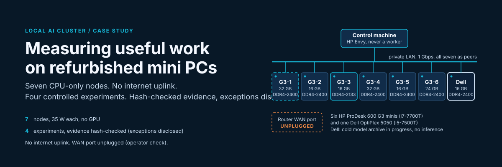
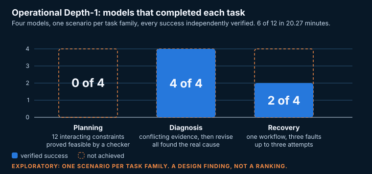
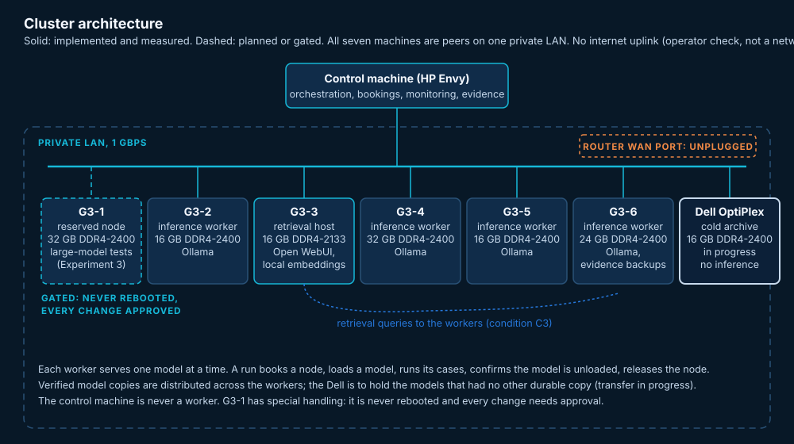
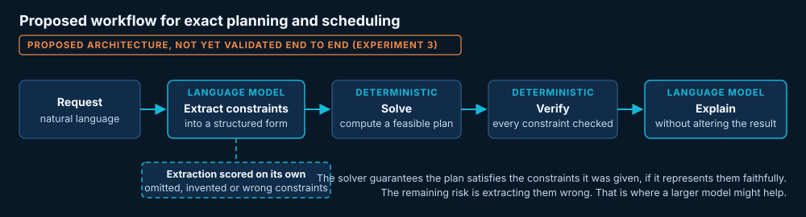
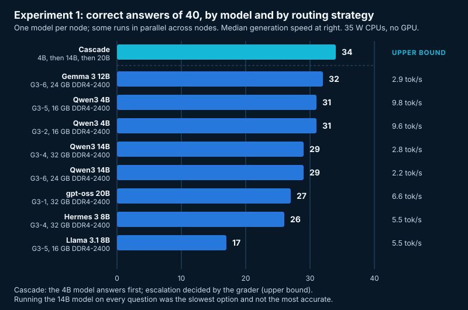
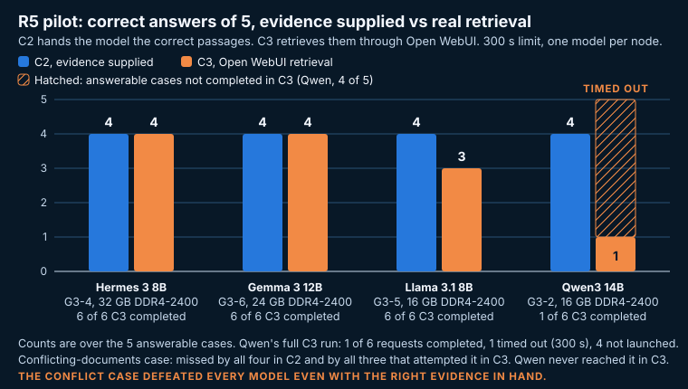
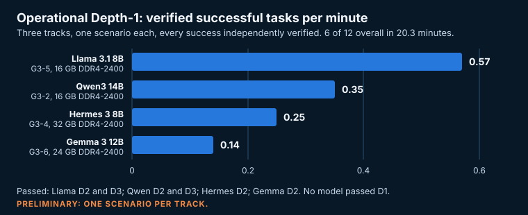

# Measuring Useful Work on a CPU-Only Local AI Cluster



**A case study in building a private, offline AI environment from seven refurbished mini PCs, and in measuring whether the models on it can do reliable work rather than just generate text.**

Manuel (Mannie) Castillo, October 2026, version 1.0. Status: four experiments complete, evidence re-hashed on 18 October 2026 with exceptions disclosed in [docs/methodology.md](docs/methodology.md); one in design. This document is a living case study and will grow as the next experiment lands. Project status is dated at the end of this page.

---

## In one paragraph

I built a seven-node, CPU-only, offline AI cluster from retired business mini PCs (six HP ProDesk 600 G3 minis and one Dell OptiPlex 5050, all on DDR4 memory, all 35-watt CPUs, no GPUs, WAN port physically unplugged), then ran a sequence of controlled experiments to find out what the local language models on it can actually be trusted to do. The question was never "can it generate an answer" but "can it complete a task correctly, reliably, and fast enough to be useful on hardware I own." Every result below was produced at 2 to 10 tokens per second, hash-verified (exceptions disclosed in docs/methodology.md), reconciled against its full design matrix, and, where a grader could not decide, adjudicated blind (by me in R5; by a blind AI reviewer in Experiment 2, a disclosed protocol deviation). The short version: these 8B to 14B models are strong at taking in evidence and revising, weak at exact multi-constraint work and at reconciling contradictions, and, in an upper-bound simulation, a tiered routing strategy beats any single model. The automation that runs all of this is custom software, described in "The software behind the cluster" below; a selected subset will be released separately.

---

## Four measured findings



| Finding | Evidence |
|---|---|
| **1. Exact multi-constraint planning points to a model-plus-solver workflow.** | All four models failed the same 12-constraint scheduling task that a deterministic checker proved feasible (Operational Depth-1). That supports investigating a model-plus-solver architecture, which reframes the routing design; one case does not prove larger models cannot do it, and the full workflow is not yet tested. |
| **2. A tiered routing strategy can beat any single model.** | In an upper-bound simulation, a small-model-first cascade reached 34 of 40 correct; the best single model reached 32 of 40 (Experiment 1). Escalation was decided with knowledge of the correct answers, so a live router with its own confidence signal is still untested. The two-question margin is within noise for 40 questions, and the comparison spans runs on different days. Running the 14B model on every question was the slowest option and not the most accurate. |
| **3. In the R5 pilot, retrieval was not the bottleneck; reasoning over conflicting evidence was.** | With evidence handed over directly, every model scored 4 of 5; through real retrieval, two models lost nothing; every model that attempted the one case with two conflicting document versions missed it (R5). |
| **4. The models are strong at diagnosis and revision.** | All four correctly revised an incident diagnosis when new evidence arrived (Depth-1); all four rejected a false premise (Experiment 2). |

Three further results worth knowing: the 14B model could not complete the two-call retrieval workflow inside a 300-second limit on a 16 GB DDR4-2400 node (G3-2) while 8B and 12B models could; a monitoring failure mid-run cancelled the workload, confirmed the model was unloaded and released the node with no human intervention; and Experiment 2's near-perfect scores (46 of 47) showed its questions were too easy to separate the models, which is why R5 was built around harder, conflicting-evidence cases.

---

## Architecture



All seven machines are peers on one private LAN; none is a switch or gateway for another. Each worker runs Ollama and serves one model at a time. The retrieval host (G3-3, 16 GB DDR4-2133) runs Open WebUI with a local embedding model and holds the private knowledge corpus. The control machine (an HP Envy laptop, never a worker) runs the automation: it books a node, loads a model, runs a batch of cases, confirms the model is unloaded, and releases the node, with every script hash-verified before it runs. G3-1 (32 GB DDR4-2400) is reserved for large-model testing and is gated: it is never rebooted and every change to it is approved. The Dell OptiPlex (16 GB DDR4-2400) is being set up as a cold archive for hash-verified copies of the models that had no other durable copy (transfer in progress, see Project status); it runs no inference.

### The hardware

Seven machines, all refurbished by hand. Memory speed is stated for every node because generation on this class of hardware is memory-bound, so it is expected to be a major variable (CPU models were not compared).

| Node | Machine | CPU | RAM | Role |
|---|---|---|---|---|
| G3-1 | HP ProDesk 600 G3 Mini | i7-7700T, 4c/8t | 32 GB DDR4-2400 | Reserved for large-model testing (gated) |
| G3-2 | HP ProDesk 600 G3 Mini | i7-7700T, 4c/8t | 16 GB DDR4-2400 | Inference worker |
| G3-3 | HP ProDesk 600 G3 Mini | i7-7700T, 4c/8t | 16 GB DDR4-2133 | Retrieval host (Open WebUI, embeddings) |
| G3-4 | HP ProDesk 600 G3 Mini | i7-7700T, 4c/8t | 32 GB DDR4-2400 | Inference worker |
| G3-5 | HP ProDesk 600 G3 Mini | i7-7700T, 4c/8t | 16 GB DDR4-2400 | Inference worker |
| G3-6 | HP ProDesk 600 G3 Mini | i7-7700T, 4c/8t | 24 GB DDR4-2400 (8 GB + 16 GB, flex mode) | Inference worker, evidence backup |
| Dell | Dell OptiPlex 5050 Micro | i5-7500T, 4c/4t | 16 GB DDR4-2400 | Cold model archive (in progress), no inference |

Several of the HPs started life with an Intel Core i5-6500T. I upgraded them to the i7-7700T, near the ceiling of what the board supports, and brought G3-4 up to 32 GB DDR4-2400 to match G3-1, so two nodes could hold models in the 14B to 27B range. The HPs run 256 GB SATA SSDs, the Dell a 240 GB SSD, and all seven have 1 Gbps Ethernet. Generation on this hardware is memory-bandwidth-bound, so a 14B dense model runs at roughly 2 to 3 tokens per second while a 4B model runs at nearly 10.

One measured detail worth knowing if you build something similar: the same 14B model generated text 24 percent faster on G3-4 (two matched 16 GB DDR4-2400 sticks in dual-channel mode) than on G3-6 (mismatched 8 GB and 16 GB DDR4-2400 sticks, where part of the memory runs single-channel). The two runs were under different conditions (G3-4 rerun alone at its thermal ceiling, G3-6 in a lock-step parallel run), and because reading the prompt takes most of each answer, the end-to-end gain per answer was only about 4 percent. Full inventory in [docs/hardware.md](docs/hardware.md).

---

## The four full reports

| Report | Question it answers | Headline |
|---|---|---|
| [Experiment 1: the bake-off](docs/experiment-1-bakeoff.md) | How do eight model-and-node combinations compare on 40 questions, and does chaining models beat picking one? | Oracle cascade 34 of 40 vs best single model 32 of 40 (upper bound: escalation decided by the grader; live router untested) |
| [Experiment 2: reasoning, memory and pushback](docs/experiment-2-reasoning.md) | Can four models reason, hold context, stay consistent and reject a false premise? | 46 of 47 correct: a ceiling effect that drove the next design |
| [R5: document intelligence](docs/r5-document-intelligence.md) | Can models answer from a private corpus through real retrieval, and is retrieval or reasoning the weak link? | Retrieval holds up; the conflicting-documents case defeats every model |
| [Operational Depth-1: demanding practical tasks](docs/operational-depth-1.md) | Can models plan under 12 constraints, diagnose from conflicting evidence, and recover a failed workflow? | 0 of 4 on planning, 4 of 4 on diagnosis, 2 of 4 on recovery |

Summaries of each follow further down this page.

---

## Methodology and safety safeguards

I spent as much effort on the measurement discipline as on the hardware, because a benchmark you cannot trust is worse than none. The rules that applied, with their disclosed exceptions:

- **One node, one model, one at a time.** Each node serves one model and one request at a time, so a model's timing is its own. Runs on the same node are sequential; in Experiment 2 and the Experiment 1 parallel check, separate nodes ran at the same time, each on its own hardware. A node is booked before a run and released after, and the release is confirmed by checking that no model is still loaded.
- **Frozen cases and frozen keys.** Test cases and their answer keys are frozen and hashed before any model sees them. Grading is deterministic against the frozen key. Answer keys never enter a model-facing prompt.
- **Human adjudication for the borderline.** When the grader cannot decide, the case goes to me, with the model identity hidden, and I rule PASS, FAIL or INVALID against the frozen criteria. One disclosed exception: in Experiment 2 the six borderline cases were ruled by an AI reviewer blind to model identity and without the key, a deviation from the frozen protocol that I ratified once after an independent AI review re-checked all six; R5 used human adjudication as specified.
- **Every expected result is accounted for.** A run is reconciled against its full design matrix. A timeout or a cancelled case is recorded as what it is, never silently dropped and never counted as a wrong answer.
- **Thermal and resource monitoring on every run from Experiment 2 on** (in the 7 October Experiment 1 runs, temperatures were read only on G3-2 and G3-4), with a 300-second per-request limit and a policy that stops a workload if monitoring itself fails.
- **Evidence is backed up and hash-verified** to a second node after each run, and the backup is checked file by file, except the 7 October Experiment 1 raw files, for which no second copy was found (see Evidence exceptions). The Operational Depth-1 and R5 pilot backups predate later edits to their run records and have not yet been refreshed; a refresh needs the cluster on and its own approval.
- **Independent review gates.** A separate reviewing agent checks scripts, launches and results at each gate before the next step, and I approve every change to the environment.
- **Safety boundaries that never moved.** The WAN port stays unplugged (my own physical check, not a network test), so the network has no internet uplink; no firewall, credential, service or scheduled-task change is made without explicit approval, and the reserved node G3-1 (32 GB DDR4-2400) is never rebooted.

Full detail is in [docs/methodology.md](docs/methodology.md).

### How AI agents were used

I designed the architecture and the experiments and made every approval decision. AI coding agents did most of the implementation under that direction: a primary coding agent (Claude Code) wrote the automation, the test harnesses, the deterministic graders and the monitoring, and ran the experiments; a separate reviewing agent acted as an independent gate, checking script hashes, launches and results at each gate before the next step was allowed, and it caught real defects, including a flawed capacity calculation and a test case whose wrong answer accidentally equalled another case's right answer; a second AI assistant (ChatGPT, used heavily throughout as a design reviewer) reviewed the experimental designs and caught errors in my own reasoning, including an impossible thermal threshold I had proposed and an unverified assumption about missing results.

Apart from the one disclosed Experiment 2 exception above, the agents did not grade the borderline cases, were not shown the answer keys (no AI reviewer or adjudicator saw them; the keys were read only by the deterministic graders, with one disclosed exception in docs/methodology.md), and did not approve changes to the environment. Those stayed with me. I think that division is the honest way to describe what "built with AI" means here: the agents multiplied what one non-engineer could do, and the discipline around them is what made the output trustworthy.

## The software behind the cluster

A large part of the work in this project is software: the scripts that set up each node, stage and register models, run the experiments, grade and reconcile the results, watch temperatures and resources, and back up and verify the evidence. They are PowerShell and Python, written mostly by the coding agent under my direction and review (see "How AI agents were used"), and they were run by hand under the review gates described above, not on a schedule. None of that code is in this repository yet. What exists, and where each piece is already visible in the results:

| Category | What exists | Where it shows in this case study |
|---|---|---|
| Node setup and inventory | A per-node setup kit run from removable media; read-only inventory and remote-management scripts for all seven nodes | [docs/hardware.md](docs/hardware.md) |
| Model staging and registration | Offline staging of model files to nodes, hash-checked copies, registration one node at a time under approval, and the model preservation transfers | [docs/roadmap.md](docs/roadmap.md), model preservation |
| Experiment harnesses | One harness per experiment (Experiment 1, Experiment 2, R5, Operational Depth-1), with node booking and release and a 300-second per-request limit | each report in docs/ |
| Grading and reconciliation | Deterministic graders against frozen keys, reconciliation against the full design matrix, blinded adjudication packets | [docs/methodology.md](docs/methodology.md) |
| Monitoring and fail-closed stops | Temperature and resource monitoring from Experiment 2 on, with a stop policy when monitoring itself fails (exercised once, in Experiment 2) | [docs/experiment-2-reasoning.md](docs/experiment-2-reasoning.md) |
| Health and acceptance checks | Scripted check sweeps of all nodes, a readiness-and-shutdown procedure for hardware work, and post-change comparison against a baseline; run by hand under review, not scheduled | [docs/methodology.md](docs/methodology.md), review gates |
| Evidence backup and verification | Per-file SHA-256 backups to a second node with receipts, dated manifests, and the external-drive dependency sweep | [docs/methodology.md](docs/methodology.md); Project status below |

A job-service prototype for distributing work across nodes also exists; it was parked before any experiment used it and is not behind any result here.

**Planned release.** I plan to publish a selected, reusable subset of these scripts in a separate repository. Before that happens: strip environment-specific paths, node mappings and credentials (filenames included); separate reusable utilities from cluster-specific and experimental pieces; add setup notes and dependencies; and choose a software licence, since CC BY 4.0 covers this case study and not code. No date yet. This repository documents what the software did; that one will show how.

---

## Current capabilities, limitations and what is next

### What the cluster can do today

Four experiments give a coherent capability map for 8B to 14B models on this hardware. They are strong at taking in evidence and updating: diagnosis, revising a conclusion, rejecting a false premise, answering from retrieved documents. They are weak at exact multi-constraint work and at reconciling contradictions: the 12-constraint schedule, the conflicting-document case. That map points at an evidence-based routing system rather than a single "best model", and after Depth-1 the router chooses not only which model but which verified tool or workflow:

- a fast small model (the 4B model in Experiment 1, the 8B models in Experiment 2), where it was among the fastest and most accurate on those sets, for straightforward requests;
- escalation to a 12B or 14B model only where a live cascade test shows it pays (the Experiment 1 cascade was an upper bound), since it nearly doubles the time per answer;
- the retrieval pipeline for anything document-grounded, where in R5 every completed answerable C3 answer had a supporting passage among its retrieved sources (16 of 16);
- a model-plus-solver workflow for exact planning and scheduling, because no model tested did it alone (the workflow itself is the next thing to test);
- and a human approval step for any task where a wrong answer matters, because the models did not resolve the one conflicting-evidence case tested.



The measure I keep coming back to is verified correct work per minute of wall-clock time on hardware I own. That number, not raw benchmark accuracy, is what decides whether a model, or a workflow, earns a place in the routing table.

### Limitations

- **Small case counts.** Six R5 cases, 12 Experiment 2 cases per model, and one scenario per Depth-1 track are enough to validate a method and surface findings, not to rank models with statistical confidence. I have avoided rankings for that reason.
- **D1 is one problem.** All four models failing one 12-constraint schedule is an observed limitation and a design opportunity, not proof that models of this size generally cannot plan.
- **One hardware class.** Everything here is a 35-watt Kaby Lake CPU on DDR4-2400 (DDR4-2133 on G3-3). The relative results may not hold on GPUs or on newer CPUs with faster memory.
- **Quantized models.** All models ran at 4-bit quantization. Quality differences between quantization levels were not tested.
- **The conflict-case failure is unexplained.** All four models missed it; I do not yet know whether it is prompting, model capability, or the case itself.
- **Experiment 1 and R5 used different question sets**, so their accuracy figures are not directly comparable to each other.

### What is next

One experiment is in design, gated, not yet run:

- **Experiment 3, larger models and the model-plus-solver workflow.** 20B to 32B models (gpt-oss 20B, DeepSeek-R1 32B, Mistral Small 24B, Qwen3 30B-A3B) on G3-1 (32 GB DDR4-2400), against matched smaller baselines on the same machine. There is already a baseline for that node: gpt-oss 20B ran on it in Experiment 1 (27 of 40, 6.6 tokens per second), so it is a known-feasible first candidate rather than a first attempt. Redesigned around the Depth-1 finding, it separates three capabilities and scores each on its own: constraint extraction (can the model turn natural-language requirements into correct structured constraints, including dependencies, prohibitions and exceptions), constraint solving and verification (can a deterministic solver produce and validate a feasible plan from them), and explanation (can the model explain the verified result without altering it). Smaller and larger models are compared on extraction before any pipeline gain is attributed to model size. It also expands D3 to at least three validated recovery scenarios per model. It begins with a resource-fit trial (does the model load, how fast, how much context) before any benchmarking.

It feeds the routing system. See [docs/roadmap.md](docs/roadmap.md).

---

## Experiment summaries

### Experiment 1: the bake-off

**Question:** on identical questions, how do the available models compare on accuracy and speed, and does chaining a small model to larger ones beat picking one?

**Setup:** a 40-question set covering factual recall, combining facts, numeric answers, questions whose answer is absent (the correct response is to say so), and false-premise questions. Eight model-and-node combinations, one model per node; some runs ran in parallel across nodes.



| Model | Node | Correct of 40 | Median tokens/s | Median answer time |
|---|---|---|---|---|
| Gemma 3 12B | G3-6, 24 GB DDR4-2400 | 32 | 2.9 | 59.7 s |
| Qwen3 4B | G3-2, 16 GB DDR4-2400 | 31 | 9.6 | 11.1 s |
| Qwen3 4B | G3-5, 16 GB DDR4-2400 | 31 | 9.8 | 10.7 s |
| Qwen3 14B | G3-4, 32 GB DDR4-2400 | 29 | 2.8 | 48.4 s |
| Qwen3 14B | G3-6, 24 GB DDR4-2400 | 29 | 2.2 | 50.8 s |
| gpt-oss 20B | G3-1, 32 GB DDR4-2400 | 27 | 6.6 | 28.2 s |
| Hermes 3 8B | G3-4, 32 GB DDR4-2400 | 26 | 5.5 | 30.3 s |
| Llama 3.1 8B | G3-5, 16 GB DDR4-2400 | 17 | 5.5 | 24.3 s |

**The routing result.** The most useful finding was not which model won but what happened when they were chained. A cascade that tries the 4B model first and escalates to a larger model whenever the smaller one's answer is wrong beat every single model on accuracy. This is an upper bound: escalation was decided with knowledge of the correct answers, which a live system does not have, so a real router needs its own confidence signal, and that is not yet tested. The cascade was computed from the 7 October runs:

| Strategy | Correct of 40 | Total time |
|---|---|---|
| Small model first, escalate to 14B, then 20B | **34** | 1101 s |
| Small model first, escalate to 14B | 33 | 880 s |
| Always the 4B model | 31 | 447 s |
| Always the 14B model | 29 | 1910 s |
| Always the 20B model | 27 | 1164 s |

Running the 14B model on every question was the slowest option and not the most accurate. That result is the seed of the routing system this whole project is working toward.

**Two other measured findings.** Running a batch across two nodes instead of one cut wall-clock time from 343 to 237 seconds for 40 answers. And the 20B model, a mixture-of-experts design, generated faster than the 14B dense model despite having more parameters, because only a fraction of its parameters are active per token.

Full report: [docs/experiment-1-bakeoff.md](docs/experiment-1-bakeoff.md)

### Experiment 2: reasoning, memory and pushback

**Question:** beyond recall, can these models reason, hold information across turns, stay consistent, and push back on a false premise?

**Setup:** four models, each on its own node (Llama 3.1 8B on G3-5, 16 GB DDR4-2400; Hermes 3 8B on G3-4, 32 GB DDR4-2400; Gemma 3 12B on G3-6, 24 GB DDR4-2400; Qwen3 14B on G3-2, 16 GB DDR4-2400), on 12 held-out cases across six behaviors: multi-step reasoning, memory across turns, consistency under a valid correction, rejecting a false premise, accepting a valid correction, and retaining context through padded filler.

**Result:** 46 of 47 completed answers were correct. Llama 12 of 12, Gemma 12 of 12, Hermes 11 of 12, Qwen 11 of 11 completed. The one scored error was a consistency slip by Hermes. The one missing case was Qwen's, cancelled when a monitoring check failed mid-run; the harness correctly cancelled the workload, confirmed the model was unloaded and released the node, and the case was excluded rather than counted wrong.

| Model | Node | Correct | Tokens/s | Correct answers per minute of wall-clock |
|---|---|---|---|---|
| Llama 3.1 8B | G3-5, 16 GB DDR4-2400 | 12 of 12 | 6.4 | 0.50 |
| Hermes 3 8B | G3-4, 32 GB DDR4-2400 | 11 of 12 | 6.3 | 0.54 |
| Gemma 3 12B | G3-6, 24 GB DDR4-2400 | 12 of 12 | 3.1 | 0.24 |
| Qwen3 14B | G3-2, 16 GB DDR4-2400 | 11 of 11 | 3.5 | 0.25 |

**The finding was the ceiling.** All four models were at or near 100 percent, which means the cases were not hard enough to tell them apart. That is a valid result, and I labelled the experiment exploratory rather than claiming a ranking from it. It also set the design requirement for the next experiment: cases hard enough to discriminate, built around evidence that conflicts.

The last column is the metric this project cares about most. Two models that both score 100 percent are not equivalent if one produces twice as many verified correct answers per minute. On this hardware the 8B models did roughly double the useful work of the 12B and 14B models in the same time. (Correct answers per minute is the final, post-adjudication correct count divided by each node's run length.)

Full report: [docs/experiment-2-reasoning.md](docs/experiment-2-reasoning.md)

### R5: document intelligence

**Question:** can the models answer questions from a private document collection through a real retrieval pipeline, cite what they used, recognise when the answer is not there, and resolve two documents that disagree? And if they fail, is it the retrieval or the reasoning that fails?

**Setup:** a private corpus of 17 fictional documents, so no model could know the answers from training. Six calibration cases, including one whose answer is absent and one where two document versions conflict. Four models, each on its own node (same model-to-node assignment as Experiment 2), under three conditions:

- **C1**: no documents at all. The correct behaviour is to abstain.
- **C2**: the correct evidence handed to the model directly. Measures reasoning with retrieval removed.
- **C3**: the full pipeline. Open WebUI on G3-3 (16 GB DDR4-2133) retrieves from the corpus, then the model answers. Measures the real workflow.

Every one of the 72 expected results (6 cases x 4 models x 3 conditions) is accounted for: 67 completed, 1 timed out, 4 never launched after that timeout, all five belonging to the 14B model in C3.



| Model | Node | C2, evidence supplied | C3, real retrieval | C3 completion |
|---|---|---|---|---|
| Hermes 3 8B | G3-4, 32 GB DDR4-2400 | 4 of 5 | 4 of 5 | 6 of 6 |
| Gemma 3 12B | G3-6, 24 GB DDR4-2400 | 4 of 5 | 4 of 5 | 6 of 6 |
| Llama 3.1 8B | G3-5, 16 GB DDR4-2400 | 4 of 5 | 3 of 5 | 6 of 6 |
| Qwen3 14B | G3-2, 16 GB DDR4-2400 | 4 of 5 | 1 of 5 | 1 of 6, timed out |

Correctness counts are over the five answerable cases; the abstention case is reported separately in the full report. Read the two Qwen numbers together: it answered 1 of the 5 answerable cases correctly because it completed only 1 of its 6 C3 cases. Correctness and completion are different measures and both are stated.

**Three findings.**

*Retrieval is not the weak link.* With evidence handed over, every model scored the same. Through real retrieval, Hermes and Gemma lost nothing and Llama lost one case. In C3, every completed answer to an answerable case (16 of 16) had at least one supporting passage among the retrieved sources (9 with an unparsed passage id), and no answer in C2 or C3 cited a passage outside the supporting or superseded set.

*Reasoning over conflict is.* The case with two disagreeing document versions was missed by all four models in C2 and by all three that attempted it in C3. No model resolved the conflict even when handed the correct evidence directly. That points to reasoning rather than retrieval; the cause is not yet determined, and it is the first thing the follow-up evaluation will target.

*The biggest model was the least practical on this path.* Retrieval through Open WebUI makes two model calls per question (it rewrites the question into a search query first, then answers). The 14B model on G3-2 (16 GB DDR4-2400) could not finish that inside the 300-second limit. Its accuracy when it finishes is not the same thing as its reliability, and a model that times out is not useful no matter how good its completed answers are.

Six borderline cases went to blind human adjudication: five passed, one failed. No C1 or C2 answer reached the 384-token output cap; C3 calls went through Open WebUI with its own parameters, so the cap did not apply there. The longest completed answer in any condition was 114 tokens.

This was a six-case calibration pilot to validate the method, and it did. I have not drawn a model ranking from it. A 24-case held-out evaluation is designed and deferred pending a decision.

Full report: [docs/r5-document-intelligence.md](docs/r5-document-intelligence.md)

### Operational Depth-1: demanding practical tasks

**Question:** can the models complete difficult multi-step work, recognise what cannot be done, and recover when something fails, rather than produce a convincing answer?

**Setup:** three task families, one scenario each, on all four models, one node at a time (same model-to-node assignment as Experiment 2). D1: produce a schedule satisfying 12 interacting constraints, checked by a deterministic verifier (an exhaustive checker had established beforehand that the problem was feasible). D2: diagnose an incident from partly conflicting evidence and revise when new evidence arrives. D3: recover one synthetic workflow containing three faults in a simulator, with up to three corrective attempts. Every success was independently verified; the metric is verified successful tasks per minute of wall-clock time.

**Result:** 12 of 12 sessions completed, 6 verified successes, in 20.3 minutes.

| Model | Node | D1 planning | D2 diagnosis | D3 recovery | Verified tasks per minute |
|---|---|---|---|---|---|
| Llama 3.1 8B | G3-5, 16 GB DDR4-2400 | FAIL | PASS | PASS, second attempt | **0.57** |
| Qwen3 14B | G3-2, 16 GB DDR4-2400 | FAIL | PASS | PASS, first attempt | 0.35 |
| Hermes 3 8B | G3-4, 32 GB DDR4-2400 | FAIL | PASS | FAIL | 0.25 |
| Gemma 3 12B | G3-6, 24 GB DDR4-2400 | FAIL | PASS | FAIL | 0.14 |



**The finding that reframes the project.** All four models failed the same feasible 12-constraint scheduling problem. Exact constraint satisfaction is a search problem, and the result suggests that a language model generating free text is the wrong instrument for it, with a deterministic solver the right one. The architecture that implies for rule-governed tasks is: the model extracts the constraints into a structured form, a solver computes a plan and an independent verifier checks it, and the model explains the verified result. In that design the solver guarantees the constraints are met whenever they were extracted correctly and the solver represents them faithfully, and the remaining risk moves to the extraction step. Two honest limits: one failed case does not prove that larger models cannot solve it, and the complete model-plus-solver workflow has not yet been tested. Both are exactly what the next experiment is designed to find out, and whether a larger model extracts constraints more reliably is now its central question.

The other two tracks fit the pattern from earlier experiments: every model handled the diagnosis and revision, and the models separated on recovery (Qwen fixed all three faults on its first attempt, Llama succeeded on its second, Hermes and Gemma did not within three). One scenario per track, and one workflow for D3, makes these meaningful and preliminary, not a ranking.

Full report: [docs/operational-depth-1.md](docs/operational-depth-1.md)

---

## Why build this

Two reasons, one practical and one personal.

The practical one: I wanted an AI environment I fully control. No cloud provider, no subscription, no internet link required for it to do its job, and a private document collection that is kept on the local network. The cluster's WAN port is physically unplugged (my own check, not a network test), so the network has no internet uplink.

The personal one: I do not come from a software engineering background. I work in EdTech sales. I wanted to find out how far someone like me could get building real infrastructure by directing AI coding agents, and whether the result would hold up to the kind of scrutiny an engineer would apply. The experiments in this document are my attempt to answer that honestly, including where the models fell short.

---

## Project status (status verified through 14 October 2026, 06:45; evidence re-hashed 18 October)

- **Experiments:** four complete, evidence re-hashed on 18 October 2026 with exceptions disclosed in docs/methodology.md (Experiment 1, Experiment 2, R5 pilot, Operational Depth-1). Experiment 3 protocol drafted and awaiting operator review; not yet run.
- **Model preservation:** a hash-verified copy of every operational model is being distributed across the cluster so that no model depends on a single external drive. The last transfer to the Dell cold archive was interrupted at 17 of 83 files (149.3 of 157.2 GB copied) by an unplanned operating-system restart of the control machine; it resumes once a free-space minimum on the Dell is decided. Six models on hold (five pending licence review, one by operator decision) are excluded from operational scope and from this archive.
- **Control-machine independence from the staging drive:** a dependency sweep found 37 active references to the external staging drive on the control machine and none on the cluster nodes inspected (G3-1 was not inspected, by rule). 32 can be repointed with reversible, hashed changes, 4 are gated pending approval, and 1 is a historical record that only documents a past location and needs no change (32 + 4 + 1 = 37). The drive was to stay connected and intact until a controlled drive-absent test passes; it was not mounted during the 18 October re-hash.
- **Safety boundaries:** unchanged. WAN port unplugged (operator check), no internet uplink, G3-1 (32 GB DDR4-2400) never rebooted.

---

## Repository map

```
README.md                          this case study
docs/
  methodology.md                   the measurement discipline in full
  hardware.md                      node inventory, memory speeds, the memory-configuration finding
  experiment-1-bakeoff.md          full Experiment 1 report
  experiment-2-reasoning.md        full Experiment 2 report
  r5-document-intelligence.md      full R5 pilot report
  operational-depth-1.md           full Operational Depth-1 pilot report
  roadmap.md                       Experiment 3, the routing system
figures/                           hero, architecture, findings and chart graphics (SVG, self-contained)
LICENSE                            CC BY 4.0
CITATION.cff                       citation metadata
```

## What is deliberately not here

This is a public version. It omits the private knowledge corpus and every answer key, all network addressing and credentials, the automation scripts (which embed environment-specific paths and will be released separately after review; see "The software behind the cluster"), and the raw per-case evidence. Case wording, the scenario details and the per-case adjudications are also withheld so the cases stay reusable. Aggregates, methods and findings are complete.

## Data and code availability

The raw evidence behind every number here (run logs, per-answer outputs, scorecards, reconciliation records and adjudication decisions, 681 files) is held privately under dated SHA-256 manifests. The scripts, harnesses and graders will be released separately under a code licence after a scrub (see "The software behind the cluster"). Per-case material is withheld so the cases stay reusable. So that any later release can be checked against this version, the digests of the private manifests as of 18 October 2026 are:

- Evidence root manifest (681 files): SHA-256 7E53323B26AC5F3E806F2D8B2697BFDA8157F530582F1C3437E9A66F0D52A26F
- Experiment logs manifest (32 files): SHA-256 C9F10ED16ED638B00BC6883A5E6B417B7108EEF97709E6CEC23CDA2A86E9DFCE

## Licence

This case study (text and figures) is licensed under the Creative Commons Attribution 4.0 International licence (CC BY 4.0). See [LICENSE](LICENSE). Code, when released, will carry its own licence.

**How to cite.** Castillo, M. (2026). Measuring Useful Work on a CPU-Only Local AI Cluster, version 1.0. GitHub repository, licensed CC BY 4.0. The CITATION.cff file in this repository carries the same metadata.

---

*Questions or corrections welcome: open an issue in this repository. If you build something like this, I would like to hear what you measured.*
